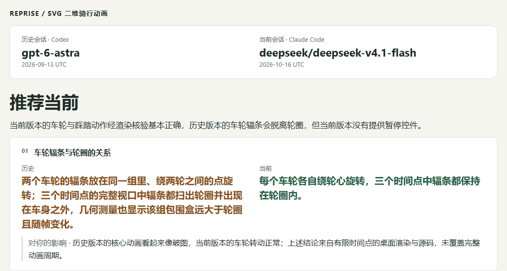
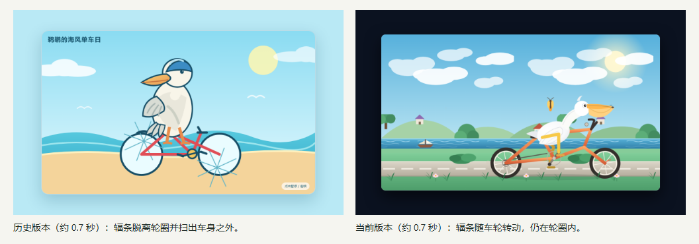
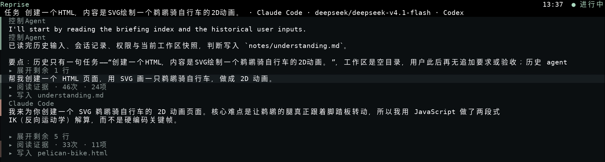

# Reprise

[English](./README.md) | [简体中文](./README.zh-CN.md)

[](https://github.com/caulif/Reprise/actions/workflows/check.yml)

**Revisit a real coding task with another agent.**

What changes when another coding agent tackles a task you have already tried? Reprise prepares a task from your saved local session, recovers a working starting point, runs a candidate, and helps you inspect the resulting work and its evidence. Recovery gaps remain visible.

> **Experimental.** Built for personal, local experiments. Windows 11 is the only platform with real terminal and Runtime validation so far; recovery is not a guarantee of an identical historical environment.

## Real results

### A pelican riding a bicycle

Reprise's generated report recommends the candidate for its wheel animation, while noting that it loses the historical version's pause control.

[](./docs/assets/reports/pelican-report.png)

*An unmodified, continuous excerpt of the report you get from Reprise (Chinese). Click for the full screenshot. Recommendations are model-generated assessments of these tasks, not a model ranking.*

The same report includes the rendered deliveries (historical left, candidate right):

[](./docs/assets/reports/pelican-report.png)

| Real task | Report recommendation | Concrete finding | Comparison generation time |
|---|---|---|---|
| [Pelican animation](./docs/examples/real-results.md#pelican) | Candidate | Wheels rotate at their hubs; pause control is missing. | 5m 33s |
| [Annotated application](./docs/examples/real-results.md#word) | Candidate | Preserves an editable diagram; final Word layout remains unverified. | 13m 16s |
| [Full-path recognition](./docs/examples/real-results.md#paths) | Historical | Better handling of relative paths containing spaces. | 17m 54s |
| [Edit self-move protection](./docs/examples/real-results.md#edit) | Historical | Broader regression coverage and more complete error documentation. | 12m 16s |

Times are the user's recorded **report-generation durations**, not task execution times or speed comparisons. [Read the original report screenshots and evidence limits](./docs/examples/real-results.md). The [pelican delivery walkthrough](./docs/examples/pelican.md) separately inspects the HTML and animation.

### See the workflow

[](./docs/assets/workflow/comparison.mp4)

[Watch the short Comparison recording (MP4)](./docs/assets/workflow/comparison.mp4) · [Recording provenance](./docs/assets/workflow/README.md)

Real terminal footage, with waiting omitted. It shows an earlier run, separate from the four reports above; it is not a continuous recording of their generation. GitHub may offer the MP4 as a download.

## When To Use It

- Revisit an important coding task with another agent or model.
- Inspect differences in delivered work, including omissions and tradeoffs.
- Keep personal task cases and evidence for later experiments.

## Quick Start

Run from source with Git, npm, and Node.js **22.19 or later**:

```powershell
git clone https://github.com/caulif/Reprise.git
cd Reprise
npm ci
npm run build
node dist/src/cli/main.js --help
```

These commands build Reprise and display help; they do not call a model or require a model key or product login. Reprise is not published to npm yet. Do not install the unrelated unscoped `reprise` package.

Start the terminal interface:

```powershell
node dist/src/cli/main.js --locale en
```

1. Open `/config`, configure the **Reprise model**, and save with `Ctrl+S`. It prepares tasks, guides execution, and compares results. An optional `Ctrl+T` connection test calls the model and may cost money.
2. Install and sign in to the **candidate tool** separately. Its model and account are distinct from the Reprise model.
3. Open `/intake`, select a source tool, project, and saved session, then review the task. Confirming this review starts preparation and may incur model costs.
4. When preparation succeeds, choose the candidate tool and model. Review the recovered workspace and limitations, then confirm execution.
5. Inspect the result and open the execution folder. Choose comparison only when you want another model call; the result page then links to the report or failure diagnostics.

Follow the [English first-run guide](./docs/getting-started.md) for configuration, stopping a run, costs, and troubleshooting.

## Requirements And Support

| Built-in tool | Import local session history | Candidate execution |
|---|---|---|
| Codex (`codex`) | Yes | Yes, through the locally installed Codex runtime |
| Claude Code (`claude-code`) | Yes | Yes, through the locally installed Claude Code runtime |

These are implemented roles, not a promise of compatibility with every tool version. Models come from the selected tool's available catalog. Reprise does not install the tools or reproduce their historical versions. A source session must already exist locally; the candidate tool must be installed and authenticated.

Windows 11 has real-use evidence, but some terminal and Runtime scenarios remain unverified. macOS and Linux CI checks do not establish real-Runtime support. See the [validation roadmap](./docs/roadmap.md) (Chinese).

## What You Get

```text
Saved session -> recovered task case -> candidate run -> local evidence and optional comparison
```

- A preserved task case with recovery findings and known gaps.
- A candidate workspace copy, event log, trace, and final response.
- An optional report comparing the historical and candidate work, with evidence and limitations rather than a universal score.

## Privacy, Cost, And Safety

- Local records do not mean offline execution: task material is sent to your configured Reprise model service; candidate tools use their own accounts and data policies. Both may incur costs.
- Review input and permissions before running. Secret filtering does not guarantee removal of all sensitive material. Workspace copies are not an operating-system filesystem or network sandbox, and external side effects are not rolled back.
- During a running stage, `Ctrl+C` requests cancellation. Wait for the resulting status and cleanup diagnostics; a cancellation request is not immediate completion.
- The normal CLI/TUI has no independent budget-setting screen. Review the [cost and cancellation guidance](./docs/getting-started.md#cost-and-cancellation) before a real run; reported cost estimates are not provider invoices.

Records default to `.reprise` in your current directory. Keep that directory private; use `--data-dir` or `REPRISE_DATA_DIR` to choose another location.

## Project Status

Reprise is experimental. The intended package name is `@caulif/reprise`, but installation currently uses source. It is not a public leaderboard, a standardized benchmark, or proof that one model is generally better. See the [roadmap](./docs/roadmap.md) for implementation limits and missing validation.

## Documentation

| Goal | Read |
|---|---|
| Complete a first run in English | [Getting started](./docs/getting-started.md) |
| Inspect a real example without installing | [Pelican case](./docs/examples/pelican.md) |
| Use the full TUI and CLI | [Usage guide](./docs/usage.md) (Chinese) |
| Understand the system | [Architecture](./docs/architecture/overview.md) (Chinese) |
| Develop and validate changes | [Development guide](./docs/development.md) (Chinese) |
| Find all documentation | [Documentation index](./docs/README.md) |

The English guide covers the first-run path; most detailed technical documentation is currently in Chinese.

## Support And Contributing / 支持与贡献

Use [GitHub Issues](https://github.com/caulif/Reprise/issues/new/choose) for questions, bugs, and feature requests in English or Chinese. Before contributing, read the [contribution guide](./docs/CONTRIBUTING.md), [code of conduct](./docs/CODE_OF_CONDUCT.md), and [development guide](./docs/development.md).

Do not post credentials, private session content, or unredacted experiment artifacts.

## Security And License

Report vulnerabilities privately through the [security policy](./docs/SECURITY.md). Reprise is released under the [MIT License](./LICENSE).
