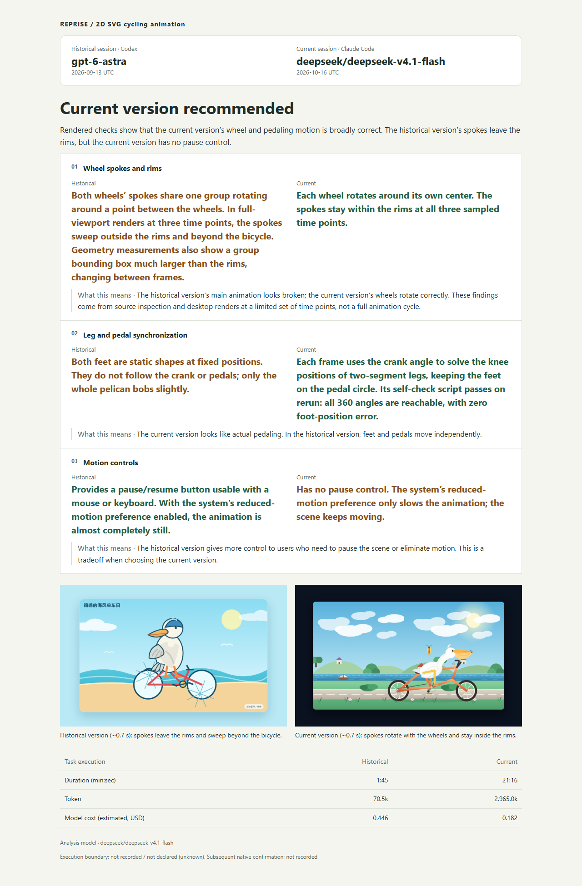
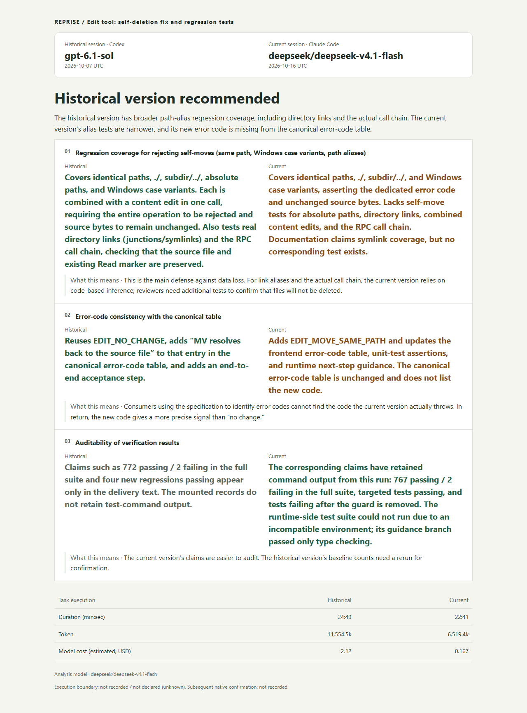
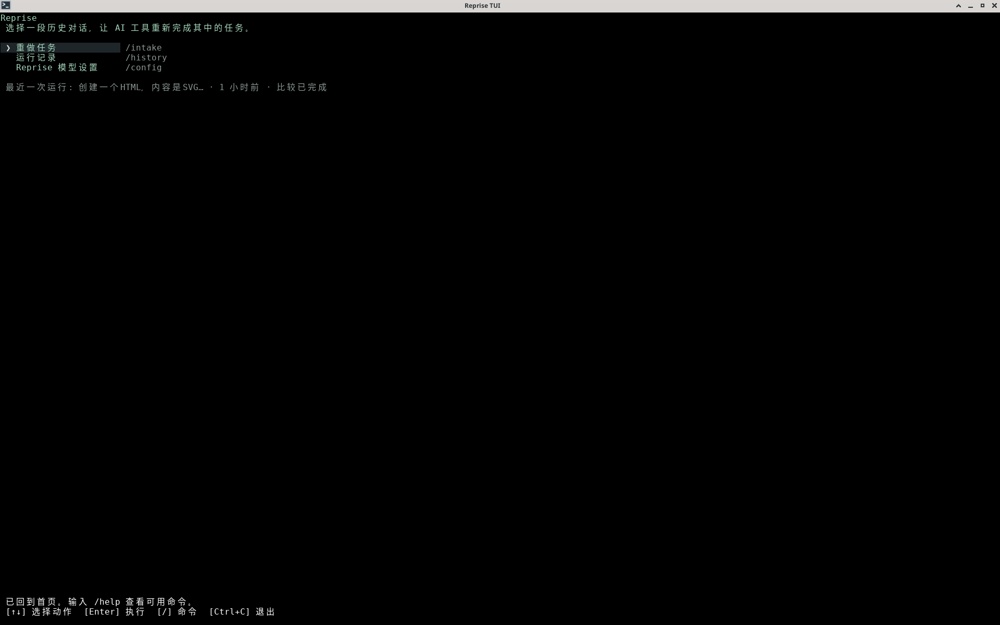
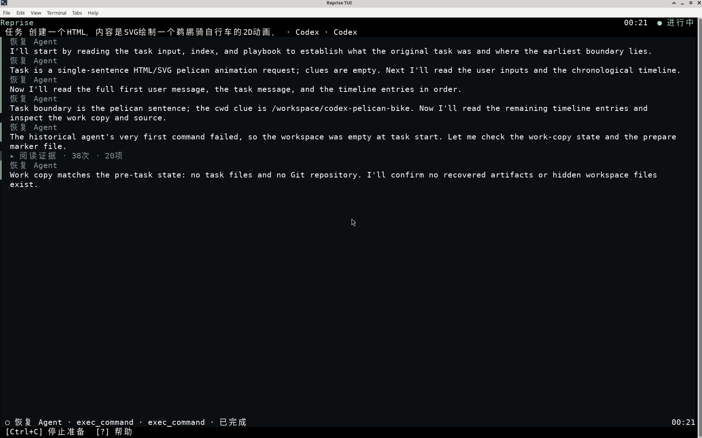
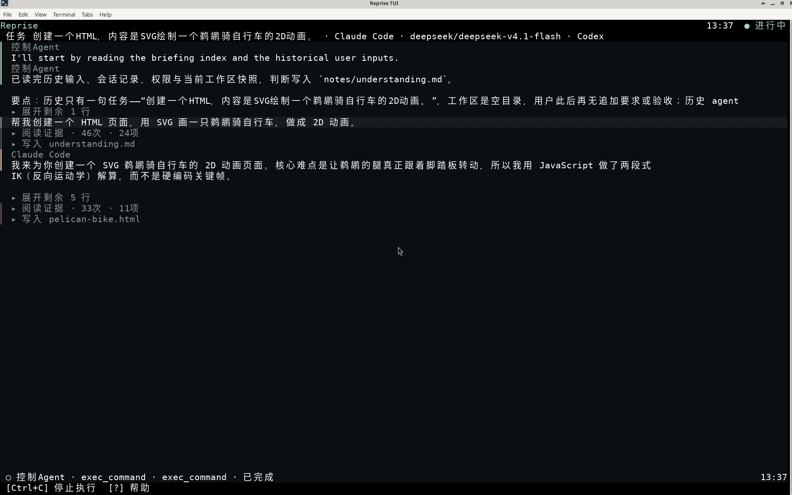
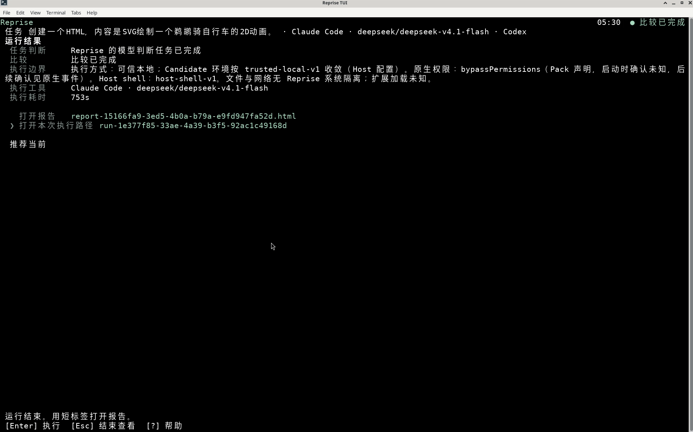

<h1 align="center">Reprise</h1>

<p align="center"><strong>Test models on your own real tasks.</strong></p>

<p align="center">
  English · <a href="./README.zh-CN.md">简体中文</a> ·
  <a href="#quick-start">Quick start</a> ·
  <a href="./docs/getting-started.md">Getting started</a>
</p>

New models keep climbing the leaderboards. On your tasks, you still find yourself explaining requirements, correcting mistakes, and checking whether the work is actually finished. Your code, workflows, and acceptance criteria deserve a place in how you choose a model.

Reprise prepares tasks from saved coding-agent sessions, recovers a usable starting point, and lets another agent or model try again. Compare the two deliveries to see what improved and what is still missing.

<p align="center">
  <a href="https://www.npmjs.com/package/@caulif/reprise">Install from npm</a> ·
  <a href="https://github.com/caulif/Reprise/releases">Releases</a>
</p>

## Result Examples

<table>
  <tr>
    <td width="50%" valign="top">
      <strong>A pelican riding a bicycle</strong>
      <p>The same SVG animation task produces different choices around wheel motion, pedaling, and pause controls. This is the actual comparison report generated by Reprise.</p>
      <a href="./docs/assets/reports/pelican-report.en.png"></a>
    </td>
    <td width="50%" valign="top">
      <strong>Edit self-move protection</strong>
      <p>The same code-fix task is compared for repair scope, regression coverage, and delivery evidence. This report favors the historical delivery's broader coverage while identifying gaps in its verification evidence.</p>
      <a href="./docs/assets/reports/edit-report.en.png"></a>
    </td>
  </tr>
</table>

Click either report to view the full-size image.

These are English translations of real generated reports, preserving the model's assessments and evidence limits. Embedded delivery screenshots retain their original content. Time measurements may cover different scopes, and costs are estimates; they do not establish relative model speed or value.

## What You Get

- **A preserved task case** from saved agent history, with recovery findings and known gaps.
- **A separate candidate workspace** with an event log, trace, final response, and retained work.
- **An optional comparison report** showing historical and candidate evidence side by side.

Three steps take you from saved history to another delivery: **recover the starting point → run a chosen tool and model → compare the results**.

### Workflow

<table>
  <tr>
    <td width="50%" valign="top">
      <strong>1. Choose a saved task</strong><br>
      Choose a tool, project, and saved session from the home screen.
      <a href="./docs/assets/workflow/01-home.png"></a>
    </td>
    <td width="50%" valign="top">
      <strong>2. Recover the starting point</strong><br>
      Recover the requirements, inspect the workspace and evidence, and record findings.
      <a href="./docs/assets/workflow/02-stage-recovery.png"></a>
    </td>
  </tr>
  <tr>
    <td width="50%" valign="top">
      <strong>3. Choose a tool and model to run the task again</strong><br>
      Choose a tool and model, then follow its progress and delivered work.
      <a href="./docs/assets/workflow/03-stage-run.png"></a>
    </td>
    <td width="50%" valign="top">
      <strong>4. Inspect the comparison</strong><br>
      Review the outcome and run records, then open the comparison report.
      <a href="./docs/assets/workflow/04-stage-compare.png"></a>
    </td>
  </tr>
</table>

Click a screenshot to open the original image. These four screenshots show one real run; the report examples above retain their own separate run records.

## Quick Start

Requires npm and Node.js **22.19 or later**.

```bash
npm install -g @caulif/reprise
reprise
```

First, configure and save the Reprise model in `/config`. Install and sign in to the execution tool separately. Choose the home action to redo a task (`/intake`), select a source tool, project, and session, then confirm the recovered starting point and choose a candidate tool and model.

`reprise --help` displays help without calling a model. Task recovery, candidate execution, and report generation require the relevant configuration and may incur model-service costs.

### Let your agent help with installation and configuration

Send this to your coding agent:

> Install and configure Reprise for me using this guide: https://github.com/caulif/Reprise/blob/main/docs/install-agent.md

<details>
<summary>Run from source</summary>

Also requires Git:

```bash
git clone https://github.com/caulif/Reprise.git
cd Reprise
npm ci
npm run build
node dist/src/cli/main.js
```

</details>

See [Getting started](./docs/getting-started.md) for configuration and your first run, or the [usage guide](./docs/usage.md) (Chinese) for the full TUI and headless CLI.

## Requirements And Support

Currently supports **Claude Code** and **Codex** only, for importing saved sessions and executing a candidate.

| Goal | Requirements |
|---|---|
| Install and inspect help | Node.js 22.19+ and npm |
| Recover a session and run a candidate | A supported tool installed locally, with saved session history |
| Call recovery, controller, or comparison models | Configure the Harness model in `/config`; calls may incur service fees |

The maintainer has tested Windows 11 and Linux. macOS has not been tested yet; you are welcome to try it and share your experience.

Records default to `.reprise` in the current directory. Use `--data-dir` or `REPRISE_DATA_DIR` to choose another location.

## Privacy, Cost, And Safety

- Records and workspace copies stay on your machine; recovery, controller, and comparison requests send task material to the Harness model service you configure.
- Candidate runtimes use their own product login and data policies. Reprise does not provide a universal network sandbox or roll back external effects.
- Review task input, permissions, privacy, and budget before running. Secret filtering does not guarantee removal of all personal or business information.

Read [data handling and credentials](./docs/usage.md#数据去向) before using real work. Use test accounts, mocks, or read-only observation for tasks with external side effects.

## Project Status

Reprise is available on [npm](https://www.npmjs.com/package/@caulif/reprise) as `@caulif/reprise`; the command is `reprise`. Release notes and packages are available in [GitHub Releases](https://github.com/caulif/Reprise/releases).

See the [roadmap](./docs/roadmap.md) for implementation limits and remaining real Runtime validation.

## Documentation

| Goal | Read |
|---|---|
| Configure and complete a first run | [Getting started](./docs/getting-started.md) |
| Use the TUI or CLI | [Usage guide](./docs/usage.md) |
| Understand modules and execution | [Architecture](./docs/architecture/overview.md) |
| Set up development and checks | [Development guide](./docs/development.md) |
| Inspect limitations and evidence | [Roadmap](./docs/roadmap.md) |
| Browse all documentation | [Documentation index](./docs/README.md) |

Most detailed technical documentation is currently in Chinese.

## Support And Contributing / 支持与贡献

Use [GitHub Issues](https://github.com/caulif/Reprise/issues/new/choose) for questions, ideas, and reproducible bugs in English or Chinese. Before contributing, read the [contribution guide](./docs/CONTRIBUTING.md), [code of conduct](./docs/CODE_OF_CONDUCT.md), and [development guide](./docs/development.md).

Do not post credentials, private session content, or unredacted experiment artifacts.

## Acknowledgements

Thanks to MiniMax for providing one month of the Ultra plan.

## Friends

[LINUX DO](https://linux.do/) — A new ideal community

## Security And License

Report vulnerabilities privately through the [security policy](./docs/SECURITY.md). Reprise is released under the [MIT License](./LICENSE).
