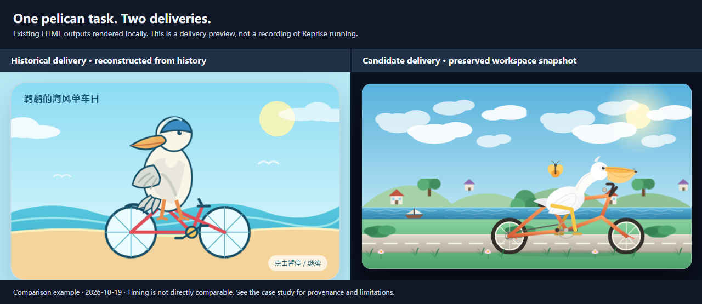

# Reprise

[English](./README.md) | [简体中文](./README.zh-CN.md)

[](https://github.com/caulif/Reprise/actions/workflows/check.yml)

**同一个真实任务，换一个 Coding Agent 重做，结果会有什么不同？**

Reprise 从本机保存的会话中准备任务，恢复工作起点，让你选择候选 Agent 重新执行，再查看交付物、过程证据和结果差异。恢复中的已知缺口会保留供你判断。

> **实验性项目。** 面向个人、本机实验。目前只有 Windows 11 有真实终端与 Runtime 使用验证；恢复起点不保证完整复现历史环境。

## 演示

### 鹈鹕骑自行车



[查看完整案例与取舍](./docs/examples/pelican-zh-cn.md) · [观看交付物动画](./docs/assets/pelican/comparison.gif)

这是真实保存的任务，不是模型排行榜。案例说明原始需求、双方交付及证据能支持的结论。对照于 2026 年 10 月 19 日使用较早的 Reprise 版本和已有候选成果生成，不是当天完整重跑，也不代表最新报告模板；记录的耗时不能直接比较。

## 什么时候使用

- 换一个 Agent 或模型，重新检验一次重要的编程任务。
- 检查交付差异，包括遗漏和各自取舍。
- 保存个人任务案例与证据，供之后重新尝试。

## 快速开始

当前从源码运行，需要 Git、npm 和 Node.js **22.19 或更高版本**：

```powershell
git clone https://github.com/caulif/Reprise.git
cd Reprise
npm ci
npm run build
node dist/src/cli/main.js --help
```

以上命令只构建并显示帮助，不调用模型，不需要模型密钥或产品登录。Reprise 尚未发布到 npm，请不要安装无关的裸名 `reprise` 包。

打开终端界面：

```powershell
node dist/src/cli/main.js --locale zh
```

1. 打开 `/config`，配置 **Reprise 模型**，按 `Ctrl+S` 保存。它负责准备任务、引导执行和比较结果；可选的 `Ctrl+T` 连接测试会调用模型，可能计费。
2. 单独安装并登录**执行工具**。执行工具的模型和账号与 Reprise 模型是两条链路。
3. 打开 `/intake`，选择来源工具、项目和历史会话，核对任务。确认核对页会开始准备任务，可能产生模型费用。
4. 准备成功后选择执行工具和模型，检查恢复后的副本与已知限制，再确认执行。
5. 查看结果并打开执行路径。需要比较时再选择“与原结果比较”，这会再次调用模型；结束后结果页提供报告或失败诊断入口。

配置、取消、费用与排障的完整路径见[使用指南](./docs/usage.md)。

## 前置条件与支持范围

| 内置工具 | 导入本机会话历史 | 候选执行 |
|---|---|---|
| Codex（`codex`） | 支持 | 支持，通过本机安装的 Codex Runtime |
| Claude Code（`claude-code`） | 支持 | 支持，通过本机安装的 Claude Code Runtime |

表中描述已实现的角色，不保证兼容工具的所有版本。模型由所选工具的可用目录提供；Reprise 不安装工具，也不复现其历史版本。来源会话必须已在本机保存，执行工具需要安装并登录。

Windows 11 已有真实使用证据，但部分终端与 Runtime 场景仍待验证；macOS、Linux 的 CI 通过不等于真实 Runtime 已验证。具体范围见[路线图](./docs/roadmap.md)。

## 你会得到什么

```text
历史会话 -> 恢复后的任务案例 -> 候选运行 -> 本机证据与可选对照报告
```

- 封存的任务案例，附恢复结论与已知缺口。
- 候选工作副本、事件日志、trace 与终稿。
- 可选的对照报告，呈现历史和当前交付的证据与限制，不压缩为统一分数。

## 隐私、费用与安全

- 本机保存不代表离线执行：任务材料会发送给你配置的 Reprise 模型服务，执行工具使用自己的账号与数据政策，两侧都可能计费。
- 运行前检查输入与权限。秘密过滤不保证清除全部敏感材料；工作副本不是操作系统文件或网络沙箱，外部副作用不会自动回滚。
- 运行中按 `Ctrl+C` 请求停止当前阶段，随后检查最终状态和清理诊断；发出取消请求不等于已立即停止。
- 普通 CLI/TUI 尚无独立预算设置入口。真实运行前阅读[费用与取消](./docs/usage.md#费用与取消)；报告估算不是供应商实账。

数据默认保存在当前目录的 `.reprise`，请保留为私有。可通过 `--data-dir` 或 `REPRISE_DATA_DIR` 更改位置。更多说明见[数据去向](./docs/usage.md#数据去向)。

## 项目状态

Reprise 仍处于实验阶段，预期包名为 `@caulif/reprise`，目前采用源码安装。它不是公共排行榜、标准 benchmark 或某模型普遍更强的证明。当前实现限制和缺失验证见[路线图](./docs/roadmap.md)。

## 文档

| 目标 | 阅读入口 |
|---|---|
| 配置并完成首次运行 | [使用指南](./docs/usage.md)；[English getting started](./docs/getting-started.md) |
| 不安装先查看真实案例 | [鹈鹕案例](./docs/examples/pelican-zh-cn.md) |
| 理解模块与执行流程 | [架构总览](./docs/architecture/overview.md) |
| 开发与验证 | [开发指南](./docs/development.md) |
| 浏览完整文档 | [文档首页](./docs/README.md) |

## 支持与贡献

提问、缺陷和功能建议请使用 [GitHub Issues](https://github.com/caulif/Reprise/issues/new/choose)，可使用中文或英文。贡献前请阅读[贡献指南](./docs/CONTRIBUTING.md)、[行为准则](./docs/CODE_OF_CONDUCT.md)与[开发指南](./docs/development.md)。

请不要公开凭据、私有会话正文或未经脱敏的实验产物。

## 安全与许可证

漏洞请按[安全政策](./docs/SECURITY.md)私下报告。Reprise 使用 [MIT 许可证](./LICENSE)。
