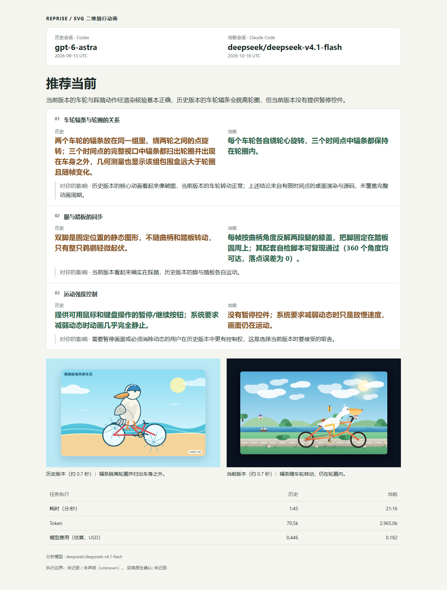
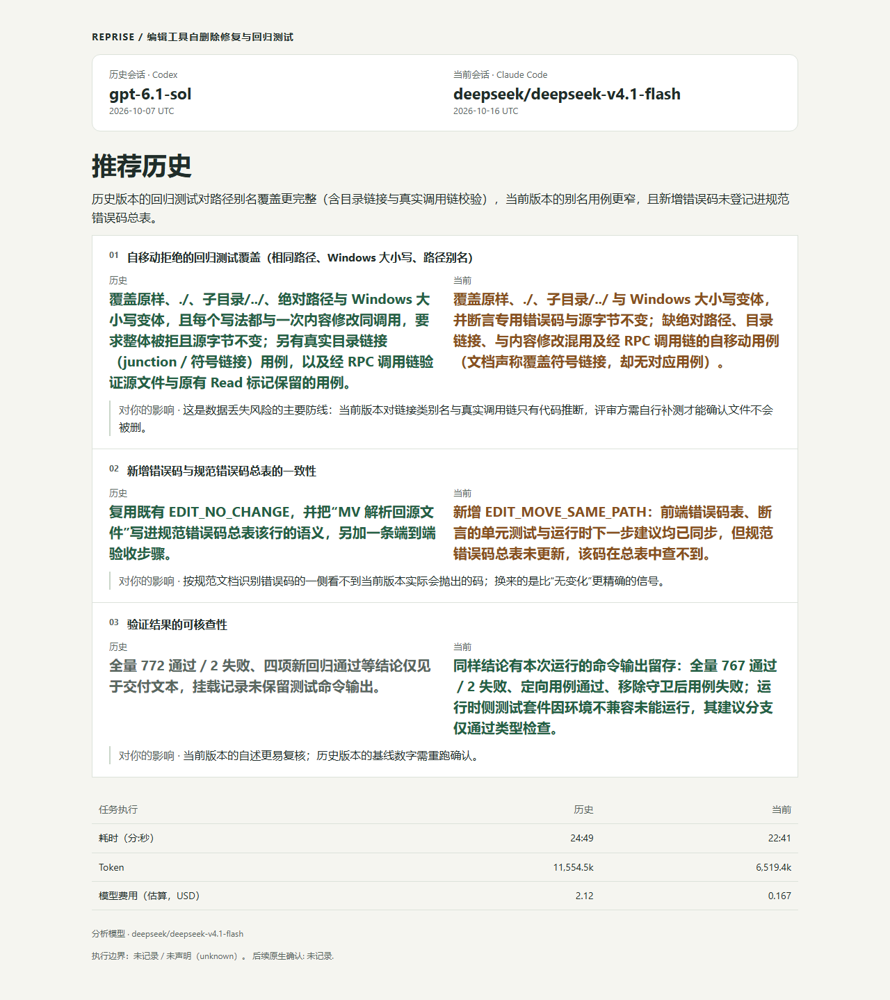

<h1 align="center">Reprise</h1>

<p align="center"><strong>用自己的真实任务，检验模型的实际表现。</strong></p>

<p align="center">
  <a href="./README.md">English</a> · 简体中文 ·
  <a href="#快速开始">快速开始</a> ·
  <a href="./docs/usage.md">使用指南</a>
</p>

新模型不断刷新榜单，到了你的任务上，还是要反复解释需求、纠错、检查有没有真正做完。你的代码、工作流程和验收要求，也值得成为选择模型的依据。

Reprise 从已有的 Coding Agent 会话中整理任务、恢复可用起点，让你选择另一个 Agent 或模型重新执行，再对照两次交付，检查哪些问题解决了、哪些地方仍有遗漏。

<p align="center">
  <a href="https://www.npmjs.com/package/@caulif/reprise">npm 安装</a> ·
  <a href="https://github.com/caulif/Reprise/releases">版本更新</a>
</p>

## 结果示例

### 鹈鹕骑自行车

同一个 SVG 动画任务，两次交付在车轮运动、踩踏动作和暂停控制上有不同取舍。下面是 Reprise 实际生成的对照报告。

<p align="center">
  
</p>

### Edit 自移动保护

同一个代码修复任务，比较修复范围、回归测试和交付证据。这次报告更认可历史交付的覆盖程度，也指出了其验证证据的缺口。

<p align="center">
  
</p>

以上为真实生成的报告，保留模型的原始判断与证据限制。报告中的任务耗时统计范围可能不同，费用为估算，不宜据此直接判断模型的速度或性价比。

## 你会得到什么

- **封存的任务案例**：从本机 Agent 历史会话中提取任务，并记录恢复结论和已知缺口。
- **独立的候选工作副本**：保留事件日志、trace、候选终稿及运行后的工作副本。
- **可选的对照报告**：将历史和候选证据并列呈现，而不是压缩成单一分数。

从历史会话到重新交付，按三个步骤完成：**恢复任务起点 → 选择工具与模型重新执行 → 对照交付结果**。

### 运行过程

<table>
  <tr>
    <td width="50%" valign="top">
      <strong>1. 选择历史任务</strong><br>
      从首页进入重做任务，选择工具、项目与会话。
      <a href="./docs/assets/workflow/01-home.png"></a>
    </td>
    <td width="50%" valign="top">
      <strong>2. 恢复任务起点</strong><br>
      整理原始需求，检查工作区与证据，记录恢复结论。
      <a href="./docs/assets/workflow/02-stage-recovery.png"></a>
    </td>
  </tr>
  <tr>
    <td width="50%" valign="top">
      <strong>3. 让候选重新执行</strong><br>
      选择工具与模型，查看执行进展和交付内容。
      <a href="./docs/assets/workflow/03-stage-run.png"></a>
    </td>
    <td width="50%" valign="top">
      <strong>4. 查看比较结果</strong><br>
      查看任务判断与运行记录，打开报告核对交付差异。
      <a href="./docs/assets/workflow/04-stage-compare.png"></a>
    </td>
  </tr>
</table>

点击截图可查看原图。这组截图展示同一次真实运行的操作流程，与上方报告案例分别保留各自的运行记录。

## 快速开始

需要 npm 和 Node.js **22.19 或更高版本**。

```bash
npm install -g @caulif/reprise
reprise
```

从首页选择「重做任务」（`/intake`），依次选择来源工具、项目和历史会话。首次运行请先在 `/config` 配置 Reprise 模型并保存；执行任务的工具需单独安装、登录。确认任务起点后，选择候选工具与模型开始运行。

仅查看命令帮助可运行 `reprise --help`，不会调用模型。恢复任务、候选执行和生成报告需要相应配置，可能产生模型服务费用。

<details>
<summary>从源码运行</summary>

还需要 Git：

```bash
git clone https://github.com/caulif/Reprise.git
cd Reprise
npm ci
npm run build
node dist/src/cli/main.js
```

</details>

完整操作步骤、模型配置和无头 CLI 用法见[使用指南](./docs/usage.md)。

## 前置条件与支持范围

目前仅支持 **Claude Code** 和 **Codex**，可导入它们的本机会话，并选择其中一个工具重新执行任务。

| 你想做什么 | 需要什么 |
|---|---|
| 安装并查看命令帮助 | Node.js 22.19+ 与 npm |
| 恢复会话并运行候选 | 本机已安装受支持的产品，且保留了本机会话历史 |
| 调用 Recovery、Controller 或 Comparison 模型 | 在 `/config` 配置 Harness 模型；这些操作可能产生服务费用 |

Windows 11 和 Linux 已由维护者实际测试。macOS 尚未测试，欢迎尝试并反馈使用情况。

默认数据目录是当前目录中的 `.reprise`。可使用 `--data-dir` 或 `REPRISE_DATA_DIR` 指定其他位置。

## 隐私、费用与安全

- 实验记录和工作副本保存在本机；但 Recovery、Controller 与 Comparison 会将完成任务所需的材料发送给你配置的 Harness 模型服务。
- 候选 Runtime 使用各自产品的登录态和数据处理规则。Reprise 不提供通用网络沙箱，也不会回滚外部副作用。
- 在真实运行前检查任务输入、权限、隐私和预算。秘密过滤不保证能够移除全部个人信息或业务内容。

使用真实工作内容前，请阅读[数据去向与凭据边界](./docs/usage.md#数据去向)，对于有外部副作用的任务应使用测试账号、mock 或只读观察。

## 项目状态

Reprise 已发布到 [npm](https://www.npmjs.com/package/@caulif/reprise)，包名为 `@caulif/reprise`，命令名为 `reprise`。版本记录与安装包见 [GitHub Releases](https://github.com/caulif/Reprise/releases)。

当前实现限制和仍待验证的真实 Runtime 行为见[路线图](./docs/roadmap.md)。

## 文档

| 目标 | 阅读入口 |
|---|---|
| 通过 TUI 或 CLI 运行 Reprise | [使用指南](./docs/usage.md) |
| 理解模块和执行流程 | [架构总览](./docs/architecture/overview.md) |
| 配置开发环境并运行检查 | [开发与验证](./docs/development.md) |
| 查看限制与验证证据 | [路线图](./docs/roadmap.md) |
| 浏览完整文档导航 | [文档首页](./docs/README.md) |

## 支持与贡献

提问、想法和可复现的缺陷请提交到 [GitHub Issues](https://github.com/caulif/Reprise/issues/new/choose)。准备贡献前，请阅读[贡献指南](./docs/CONTRIBUTING.md)、[行为准则](./docs/CODE_OF_CONDUCT.md)和[开发与验证](./docs/development.md)。

请不要在公开内容中贴出凭据、真实会话正文或未经脱敏的实验产物。

## 致谢

感谢 MiniMax 提供的一个月 Ultra 套餐支持。

## 友情链接

[LINUX DO](https://linux.do/) — 新的理想型社区

## 安全与许可证

漏洞请按[安全政策](./docs/SECURITY.md)私下报告。Reprise 使用 [MIT 许可证](./LICENSE)。
