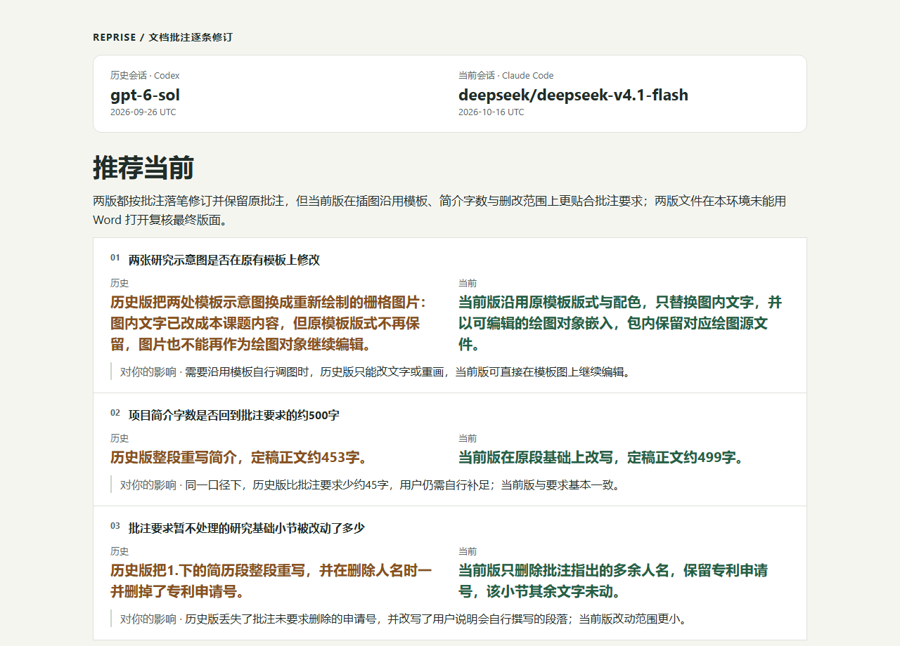
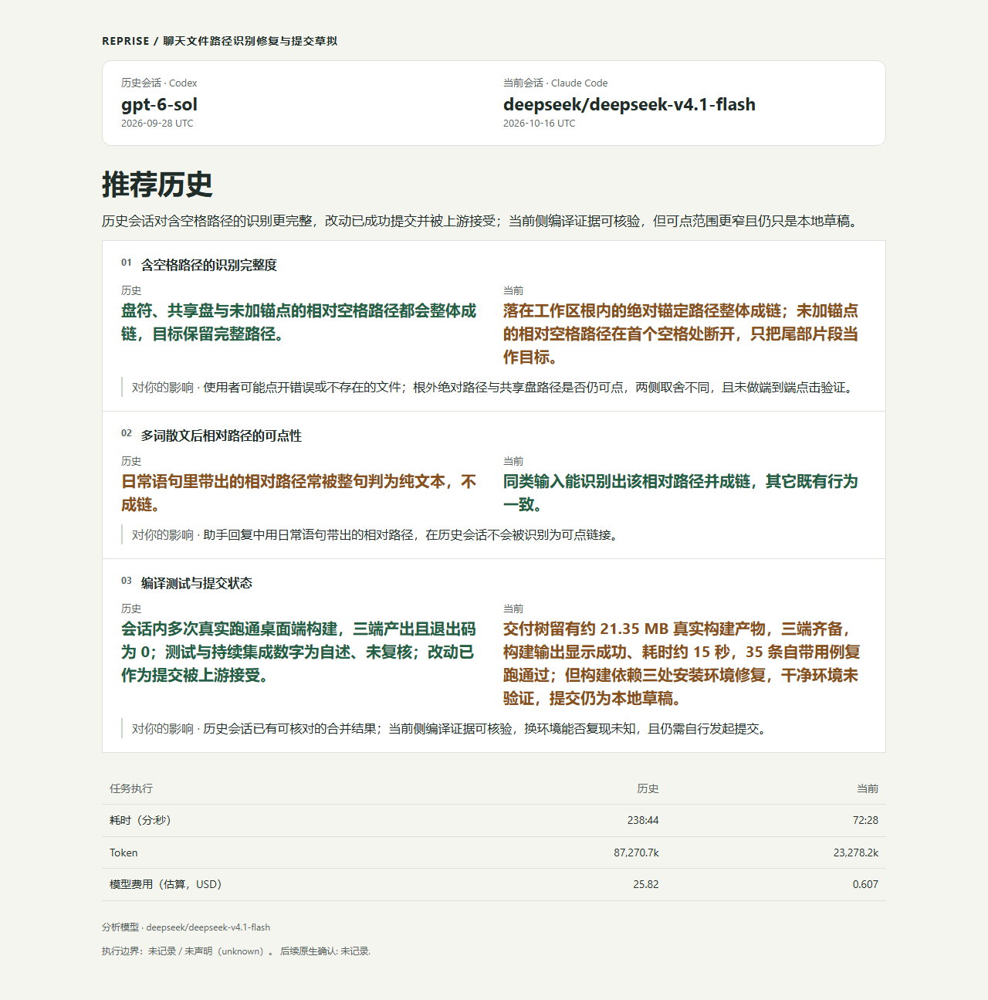

# Real comparison reports · 真实对照报告

These screenshots come from four actual Reprise reports supplied by the maintainer. They show the generated reports, not a redesigned mockup. The recommendations below are the comparison model's judgments about these particular task results, not independently established model rankings.

以下截图来自维护者提供的四份真实 Reprise 报告，保留原报告布局。表中推荐是对照模型对这些具体任务结果的判断，不代表经过独立验证的模型排名。

| Case / 案例 | Report recommendation / 报告推荐 | What the report found / 报告发现 | Comparison duration / 对照报告生成耗时 |
| --- | --- | --- | --- |
| [Pelican animation / 鹈鹕动画](../assets/reports/pelican-report.png) | Current / 当前 | Better wheel rotation; missing pause control / 车轮旋转更合理，但缺少暂停控件 | 5m33s |
| [Annotated proposal / 批注申请书](../assets/reports/word-report.png) | Current / 当前 | Preserved editable diagrams and limited changes / 保留可编辑模板图，修改范围更贴合批注 | 13m16s |
| [File path recognition / 完整路径识别](../assets/reports/paths-report.png) | Historical / 历史 | More complete handling of paths containing spaces / 对含空格路径的识别更完整 | 17m54s |
| [Edit self-move protection / Edit 自移动保护](../assets/reports/edit-report.png) | Historical / 历史 | Broader regression coverage for path aliases and real call chains / 路径别名与真实调用链回归覆盖更完整 | 12m16s |

The durations above are the maintainer's recorded **Comparison-stage durations**. They were not independently remeasured for this page. They are not the task execution times shown inside the reports, and exclude Recovery and candidate execution. These examples are not a speed benchmark; the historical and current task-time scopes, particularly in the path case, are not directly comparable. Token counts and estimated costs in the screenshots are original report fields, not independently audited comparisons.

上表耗时来自维护者记录的 **Comparison 阶段耗时**，本页未重新计时；它们不是截图中的任务执行耗时，也不包含 Recovery 与候选执行。这些案例不构成速度基准：尤其路径案例中，历史侧与当前侧的任务耗时范围不能直接比较。截图中的 Token 与估算费用保留原报告字段，不代表独立审计后的对比结果。

## Pelican animation · 鹈鹕动画

The report recommends the current result while retaining a concrete tradeoff: it has no pause control. Its statement about zero foot-position error comes from the candidate's self-test and remains a report claim; it does not establish visually exact foot-to-pedal contact. See the [pelican case notes](pelican.md) for the separate evidence and limitations of that example.

报告推荐当前结果，同时保留了缺少暂停控件的具体取舍。截图中的“落点误差为 0”来自候选的自检，是原报告表述，不能据此认定画面中的脚与踏板精确重合。[鹈鹕案例说明](pelican.md)另有该案例的证据与限制。

## Annotated proposal · 批注申请书

This is a continuous top excerpt of the original report; research diagrams below it are omitted. The report explicitly states that neither document's final layout was verified in Word. The original proposal and editable documents are not included.

这是原报告顶部的连续节选，下方研究示意图未公开。原报告明确说明：两份文档均未能在 Word 中复核最终版式。这里不提供原始申请书及可编辑文档。

## File path recognition · 完整路径识别

The report prefers historical handling of paths containing spaces, but also records a case where the current version better recognizes relative paths embedded in prose. End-to-end clicking and a clean-environment rebuild were not established for the current result.

报告更认可历史版本对含空格路径的处理，也记录当前版本在“自然语句后的相对路径”上的优势。当前结果未建立端到端点击及干净环境重建验证。

## Edit self-move protection · Edit 自移动保护

The report prefers the historical regression coverage while noting that historical test totals were self-reported and need confirmation. The current result retained more directly inspectable command output. Recommendation and evidence quality are distinct.

报告更认可历史版本的回归覆盖，同时注明历史测试总数来自自述，仍需确认；当前结果保留的命令输出更容易复核。推荐方向与证据可核查程度是两回事。

## Source reports · 来源报告

These identifiers tie the screenshots to the maintainer's source reports. Raw report HTML and private local paths are not published here. The separate TUI workflow recording comes from another run and must not be read as the execution trace of these four reports.

以下标识用于对应维护者提供的源报告；此处不公开原始 HTML 或本机路径。另附的 TUI 流程录像来自另一轮运行，不应视为这四份报告的执行轨迹。

| Case / 案例 | Source report ID / 源报告标识 |
| --- | --- |
| Pelican / 鹈鹕 | `716c768e-2742-4535-8081-b7b65c18316a` |
| Proposal / 申请书 | `554c6912-e465-495e-bec5-32a1b1f25740` |
| Paths / 路径 | `f2e999df-31df-4626-9cde-0bebdcf9495f` |
| Edit | `8af673ef-1e12-4316-9819-8d0c1cac4e20` |
